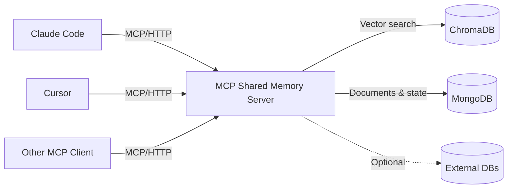
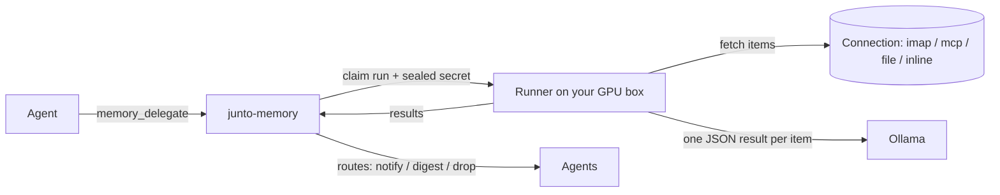

# MCP Shared Memory Server (`junto-memory`)

[](https://github.com/tlemmons/junto-memory/actions/workflows/ci.yml)
[](https://opensource.org/licenses/MIT)


> The **memory** component of the **[Junto](https://github.com/tlemmons/junto-stack)** multi-agent coordination system. For a working stack with docker-compose + adopter walkthrough, start at [`junto-stack`](https://github.com/tlemmons/junto-stack).

**A shared memory and coordination server for multiple AI coding agents, built on the Model Context Protocol (MCP).**

> 📋 **Running a server already?** See [`CHANGELOG.md`](CHANGELOG.md) for release notes — the current release (1.39.0) changes how global guidelines are seeded and generalizes the `execute-don't-ask` default; each has an upgrade note.

> [!IMPORTANT]
> **This is meant to be set up by an AI agent, not installed by hand.** Junto exists to coordinate fleets of coding agents, so the install is written for one of those agents to read and run — clone the repo and hand it to a Claude Code (or any MCP-capable) session, and let it drive. The commands in this README and in [`AGENT_INSTALL.md`](AGENT_INSTALL.md) are there so you can follow along and so the agent has something exact to execute; they are **not** a hand-tuned human tutorial, and reading them straight through isn't the intended path. You stay in control — the agent pauses for every real decision (passwords, ports, auth). If handing setup to an agent isn't something you'd want to do, this probably isn't the tool for you.

When you run multiple AI agents on the same codebase, three things break fast:

1. **They forget everything between sessions.** Agent parks, knowledge dies. The next agent re-reads the same code, re-discovers the same bugs, re-learns the same gotchas.
2. **They step on each other.** Two agents modify the same file. Nobody knows what anyone else is doing or has locked.
3. **They get dumber as sessions get long.** Research calls this "context rot" — model performance degrades as the context window fills up. Eventually every agent has to hand off; without a shared brain that handoff throws away everything it learned.

This server fixes all three. It gives your agents a shared brain that persists across sessions, coordinates work across agents, and lets them record what they learn so the next agent starts where the last one left off.

**Battle-tested.** This has been running in production coordinating 6 specialized agents across 500+ sessions on a commercial IoT platform — C#/.NET server, Python on Raspberry Pi, .NET MAUI mobile, MQTT, Redis, the works. The problems it solves were discovered the hard way.

---

## What It Does

- **Persistent knowledge base** -- Store architecture docs, learnings, gotchas, and code snippets that survive across sessions and are searchable via vector similarity (ChromaDB).
- **Multi-agent coordination** -- File locking, inter-agent messaging, heartbeat monitoring, and overlap detection so multiple AI agents can work on the same codebase without stepping on each other.
- **Task and backlog management** -- Track work items, assign tasks to agents, manage checklists, and hand off context between sessions.
- **Function registry with auto-enrichment** -- Register functions once, and a librarian daemon analyzes the source code to add signatures, gotchas, and semantic search summaries.
- **Local-model delegation** -- Agents hand routine text work (classify, extract, summarise, watch a mailbox) to a model running on your own hardware via Ollama, on a schedule or once, with results routed back to agents. Saves cloud-agent usage for work that doesn't need it. See [Local-Model Delegation](#local-model-delegation).
- **Admin web UI** -- `/admin` on the server: settings, agents and their context fill, alerts, local tasks and runs, connections, and a change log. See [Admin Web UI](#admin-web-ui).

---

## How It Compares

There are 370+ MCP memory servers listed on PulseMCP. Most give a single agent persistent memory. This server is built for **teams of agents** working together on the same project over weeks and months.

| Capability | Typical MCP Memory Server | This Server |
|---|---|---|
| Persistent storage | Yes | Yes — MongoDB + ChromaDB vector search |
| Multi-agent session tracking | No | Yes — Agent registry, heartbeat, overlap detection |
| Cross-agent messaging | No | Yes — Send/receive messages with threading and status tracking |
| Function registry | No | Yes — Register once, librarian daemon auto-enriches with code analysis |
| Task backlog | No | Yes — Create tasks, assign to agents, track status and priority |
| Versioned specs & contracts | No | Yes — Owner enforcement, semver history |
| File locking | No | Yes — Atomic locks with stale detection, auto-release on session end |
| Behavioral guidelines | No | Yes — Set rules once, every agent on every machine receives them |
| Staleness management | No | Yes — Age warnings, supersede, archive, bulk cleanup by tag |
| Librarian mode | No | Yes — Agents analyze source code and enrich the knowledge base |
| External database access | No | Yes — Read-only SQL queries (MSSQL, MySQL) against your project databases |
| Checklists | No | Yes — Shared launch readiness, deploy steps, etc. |
| Local-model delegation | No | Yes — Agent-owned tasks run on a local Ollama runner; results routed to agents or a daily digest |
| Secrets for data sources | No | Yes — Encrypted vault; agents request connections, the operator activates them, agents never see the secret |
| Operator web UI | No | Yes — `/admin`: settings, agents, alerts, tasks, connections, change log |

63 tools across 23 categories. Not a toy — a coordination system.

---

## Works for Solo Agents Too

You don't need multiple agents to benefit from this server. A single Claude Code or Cursor instance gets:

- **Persistent memory across sessions** — your agent remembers what it learned yesterday
- **Function registry** — the agent doesn't re-read code it already analyzed
- **Learnings** — gotchas, workarounds, and non-obvious behaviors survive session restarts
- **Librarian enrichment** — your codebase gets indexed and searchable over time
- **Backlog** — track what's done and what's next between sessions
- **State specs** — resume exactly where you left off

The coordination features (messaging, file locks, multi-agent awareness) just sit there unused. They don't hurt anything — they're tools your agent doesn't call until you scale up.

**Start with one agent. The multi-agent features are there when you're ready — they don't get in the way until you need them.**

---

## Architecture



The server runs as a single Docker Compose stack. AI agents connect over MCP (streamable HTTP transport on port 8080). All knowledge, messages, and coordination state are persisted across restarts in MongoDB and ChromaDB volumes.

---

## Install — Hand It to Your AI

This server is designed for AI coding agents, so the install procedure is too. Clone the repo, then ask your agent to install it for you:

```bash
git clone https://github.com/tlemmons/junto-memory.git
cd junto-memory
# Now hand the prompt below to your AI agent in a fresh session.
```

Copy this prompt to a fresh Claude Code (or Cursor, or any MCP-capable agent) session in the cloned directory:

> Install the MCP Shared Memory Server in this repository for me. Read `AGENT_INSTALL.md` and follow it step by step. Use the root-level `docker-compose.yml`. Stop and confirm with me before any destructive operation, before any change that needs a real value (passwords, API keys, port choices), and before enabling auth. When the install is done, run the smoke test described in the doc and report all six done-when results back to me.

The agent walks through prerequisites, env-file configuration, container start, health check, and MCP-client config — pausing at the right places to ask you for decisions (passwords, ports, auth on/off).

**Why this way?** The install has accumulated enough operational gotchas — Chroma volume mount path, Mongo init credentials, the auth env-var with soft-fallback, the difference between localhost and remote-host trust models — that a 6-line quickstart misleads more often than it helps. `AGENT_INSTALL.md` is dense, branchy, and tested against the actual current code; an agent reads and executes it in a few minutes. If you don't trust an AI agent to run the install, this server is probably not for you — its whole purpose is to coordinate fleets of AI agents working on real codebases.

**Doing it by hand anyway?** `AGENT_INSTALL.md` is legible to a person and the install works if you follow it carefully — but it's written for an agent to execute, so it's dense, branchy, and light on the hand-holding a human tutorial would give. The agent-driven path above is the supported one.

After install, MongoDB listens on `localhost:27019`, ChromaDB on `localhost:8001`, and the MCP server on `localhost:8080`.

### Your First Session

Once connected, your agent's first interaction looks like this:

```
Agent: memory_start_session(project="my-app", claude_instance="main")
→ Returns: session ID, any prior learnings, active work, handoff notes

Agent: memory_record_learning(
    session_id="...",
    topic="postgres connection pooling",
    content="PgBouncer silently drops connections after 5 min idle.
             Must set keepalive_idle=60 in connection string or
             requests fail with 'server closed the connection unexpectedly'."
)
→ Stored. Next session, memory_start_session returns this automatically.

Agent: memory_register_function(
    session_id="...",
    name="retry_with_backoff",
    file_path="src/utils/resilience.py:42",
    purpose="Retry async calls with exponential backoff and jitter",
    gotchas="Max 5 retries. Raises RetryExhausted, not the original exception."
)
→ Registered. Any future agent asking "how do we handle retries?"
  finds this via memory_find_function.
```

Three calls. Your agent now has persistent memory, and every future session starts with context instead of a blank slate.

---

## Connecting Your AI

### Claude Code

Add to `~/.claude.json` (or your project's `.mcp.json`):

```json
{
  "mcpServers": {
    "shared-memory": {
      "type": "http",
      "url": "http://localhost:8080/mcp"
    }
  }
}
```

> **Note on transport naming:** the underlying MCP protocol is "streamable HTTP", but the value in the JSON config file is `"http"` for Claude Code 2.x. Using `"streamable-http"` in the config triggers a schema validation error.

### Cursor

Add to `.cursor/mcp.json` in your project root:

```json
{
  "mcpServers": {
    "shared-memory": {
      "type": "http",
      "url": "http://localhost:8080/mcp"
    }
  }
}
```

### Any MCP-Compatible Client

Point your client to the MCP endpoint:

```
URL:       http://localhost:8080/mcp
Transport: Streamable HTTP (stateless)
```

**Stdio transport** is also supported for clients that prefer it. Pass `--transport stdio` when starting the server:

```bash
# From the project root:
python server.py --transport stdio

# Or as a module (from the src/ directory):
python -m shared_memory --transport stdio
```

Example MCP client config for stdio mode:

```json
{
  "mcpServers": {
    "shared-memory": {
      "type": "stdio",
      "command": "python",
      "args": ["-m", "shared_memory", "--transport", "stdio"],
      "cwd": "/path/to/mcp-shared-memory/src"
    }
  }
}
```

No API keys or authentication tokens are required for local use (see [Security](#security) for remote deployments).

---

## Tool Reference

63 tools organized into 23 categories. (For the canonical, current list with grouping and end-to-end flows, see the architecture spec inside the server: `memory_get_spec(name="architecture:shared-memory-v1", project="junto")`.)

### Session Management (2)

| Tool | Description |
|------|-------------|
| `memory_start_session` | Register a session and receive context: recent learnings, active agents, file locks, pending signals. Call this first. |
| `memory_end_session` | Record a summary, files modified, and handoff notes. Releases all locks. Call this when done. |

### Knowledge Base (4)

| Tool | Description |
|------|-------------|
| `memory_query` | Search the knowledge base by natural language. Returns relevant docs with relevance scores. |
| `memory_get_by_id` | Retrieve a specific document by its exact ID. |
| `memory_store` | Store a new document (architecture, API spec, code snippet, interface contract, etc.). |
| `memory_record_learning` | Quick shortcut to record a learning, gotcha, or technique for other agents. |

### Search and Discovery (2)

| Tool | Description |
|------|-------------|
| `memory_search_global` | Search across all projects and shared collections at once. |
| `memory_list_projects` | List all projects with document counts. No session required. |

### File Locking (3)

| Tool | Description |
|------|-------------|
| `memory_lock_files` | Atomically lock files for exclusive editing. Supports directory locks. Auto-releases on session end. |
| `memory_unlock_files` | Release specific file locks or all locks held by your session. |
| `memory_get_locks` | View current file locks with stale detection (inactive > 30 min). |

### Backlog Management (4)

| Tool | Description |
|------|-------------|
| `memory_add_backlog_item` | Add a task, feature request, or tech debt item to the backlog. |
| `memory_list_backlog` | List backlog items with filters: project, status, priority, assignee, milestone. |
| `memory_update_backlog_item` | Update a backlog item's status, priority, assignee, or description. |
| `memory_complete_backlog_item` | Mark a backlog item as done or won't-do, with optional resolution notes. |

### Inter-Agent Messaging (7)

| Tool | Description |
|------|-------------|
| `memory_send_message` | Send a message to another agent. Supports categories (task, question, blocker, etc.) and threading. |
| `memory_get_messages` | Get pending messages for your agent. Scoped by project. |
| `memory_acknowledge_message` | Mark a message as received (shortcut for status update). |
| `memory_update_message_status` | Track message lifecycle: pending, delivered, received, completed, failed. |
| `memory_heartbeat` | Send a heartbeat with your current status (idle, busy, error). Enables stale detection. |
| `memory_get_agent_status` | Get heartbeat status of agents. Flags agents stale after 5 minutes. |
| `memory_list_agents` | Discover registered agents across projects with roles and last activity. |

### Function Registry (5)

| Tool | Description |
|------|-------------|
| `memory_register_function` | Register a function reference with name, file, purpose, and optional gotchas. Triggers librarian enrichment. |
| `memory_find_function` | Search for functions by purpose or name. Check before implementing to avoid duplication. |
| `memory_enrich_function` | Add deep analysis to a function ref: signature, parameters, side effects, complexity. For librarian use. |
| `memory_get_enrichment_queue` | View functions awaiting librarian enrichment. |
| `memory_become_librarian` | Get a prompt and unenriched functions to run local enrichment on your machine. |

### Spec Management (3)

| Tool | Description |
|------|-------------|
| `memory_define_spec` | Create or update a versioned spec with owner-only enforcement. Supports semver and history. |
| `memory_get_spec` | Retrieve a spec by name, optionally at a specific historical version. |
| `memory_list_specs` | List all specs with optional version history and type filtering. |

### Project Registry (1 CRUD tool)

| Tool | Description |
|------|-------------|
| `memory_project` | Manage projects and agents. Actions: `create`, `get`, `list`, `delete`, `add_agent`, `remove_agent`, `update_agent`. |

### Checklists (1 CRUD tool)

| Tool | Description |
|------|-------------|
| `memory_checklist` | Shared checklists for launch readiness, deploy steps, etc. Actions: `create`, `get`, `add`, `check`, `delete`, `list`. |

### External Database Queries (1 CRUD tool)

| Tool | Description |
|------|-------------|
| `memory_db` | Read-only queries against registered external databases. Actions: `list`, `schema`, `query`. SQL injection protection built in. |

### Server-Managed Guidelines (1)

| Tool | Description |
|------|-------------|
| `memory_guidelines` | Manage behavioral rules that all agents receive at session start. Actions: `list`, `set`, `delete`, `get`. Update once, every agent on every machine picks it up. |

### Admin (1 CRUD tool)

| Tool | Description |
|------|-------------|
| `memory_admin` | Manage API keys and view audit logs. Actions: `create_key`, `revoke_key`, `list_keys`, `audit_log`, `auth_status`. Requires owner role when auth is enabled. |

### Document Lifecycle (4)

| Tool | Description |
|------|-------------|
| `memory_update_work` | Update your current work status and files touched. Enables overlap detection and dependency signaling. |
| `memory_change_status` | Change a document's status: active, deprecated, superseded, archived. Preserves history. |
| `memory_archive_by_tag` | Bulk archive all documents matching a tag (e.g., end-of-version cleanup). |
| `memory_restore_by_tag` | Bulk restore previously archived documents by tag. |

### Coordination & Activity (2)

| Tool | Description |
|------|-------------|
| `memory_get_active_work` | See what other agents are currently working on — tasks, files touched, timestamps. Avoid overlap. |
| `memory_claim_message` | Claim a message so exactly one agent in a group handles it (multi-consumer coordination). |

### Reminders & Scheduling (3)

| Tool | Description |
|------|-------------|
| `memory_set_reminder` | Schedule a message to your future self (or a peer) at a specific time — deadlines, follow-ups, "ping me after X". |
| `memory_cancel_reminder` | Cancel a previously scheduled reminder. |
| `memory_list_reminders` | List your pending scheduled reminders. |

### Skills (6)

Reusable, task-invoked how-to procedures. Authored as `draft`, promoted to `active` through a trust gate, and materialized into `.claude/skills/` by a launcher so the client's native matcher fires them mid-task.

| Tool | Description |
|------|-------------|
| `memory_register_skill` | Author a reusable skill (trigger + steps + gotchas + preconditions). Always creates a `draft`. |
| `memory_confirm_skill` | Promote a draft skill to `active` — the trust gate. Owner/human only. |
| `memory_get_skill` | Fetch one skill's full body by id or name. |
| `memory_list_skills` | List skills (headers) scoped by project/role/directory/status. Pinned first, then active. |
| `memory_pin_skill` | Pin/unpin a skill so it ranks first in surfacing. |
| `memory_export_skills` | Export active, scope-matched skills as ready-to-write `SKILL.md` payloads for a launcher to materialize. |

### Behavioral Directives (1)

| Tool | Description |
|------|-------------|
| `memory_ack_directive` | Acknowledge a server-issued directive (e.g. a park or behavioral instruction) so it clears. |

### Push-Control, Alerts & Telemetry (2)

Operator visibility into the messaging rate-limit / push-control subsystem (chain-depth caps, per-agent hourly budgets, silent suppression).

| Tool | Description |
|------|-------------|
| `memory_list_alerts` | List push-control alerts — budget warnings, budget breaches, hard-ceiling trips — for an operator dashboard or polling fallback. |
| `memory_get_emission_stats` | Per-agent message-emission counters and budget usage. |

### Team Status & Health (3)

| Tool | Description |
|------|-------------|
| `memory_report_context` | Report agents' context-window fill from any machine (used by the per-box `contrib/context-report` reporter). `memory_get_agent_status` then shows every agent's context gauge, and the idle→park nudge uses it (see [Context Gauge and Idle-Park Nudge](#context-gauge-and-idle-park-nudge)). |
| `memory_standup` | Auto-compiled team standup for a project — every agent's current task, blockers, stale state specs, and an aggregated decision queue. Read-only, needs no agent to produce it. |
| `memory_health` | Server health — MongoDB + ChromaDB status and active session/lock/signal counts. No session required. |

### Replication / Sync (2, server-to-server)

Phase-2 local-first replication endpoints (`admin`/`owner` tier). A LAN-local junto-memory reconciles with a central instance by shipping op-log entries — peers never re-embed text.

| Tool | Description |
|------|-------------|
| `memory_sync_pull` | Pull op-log entries newer than the caller's per-origin cursor. |
| `memory_sync_push` | Apply a batch of op-log entries received from a peer (seq-monotonic, intent-deduped). |

### Backlog — bulk (1)

| Tool | Description |
|------|-------------|
| `memory_batch_backlog` | Create or update many backlog items in one call. |

### Local-Model Delegation (4)

Hand work to a model on your own hardware. How it works: [Local-Model Delegation](#local-model-delegation).

| Tool | Description |
|------|-------------|
| `memory_delegate` | Create a task for the local model: data source (scope), instructions, JSON output schema, routes, optional schedule and canaries. No schedule = run once now. Can request a new connection in the same call. |
| `memory_schedule` | Manage your tasks: `list`, `get`, `edit` (versioned), `pause`, `resume`, `delete`, `run_now`, `history`, `runs`, `approve` (operator). |
| `memory_job` | One run: `status`, `result` (each item's output and the route it took), `cancel`. Owner only. |
| `memory_runners` | Runners and connections: `list` (hosts, models, last heartbeat), `scopes` (connections you can use), `request_connection`; operator-only `define_scope`, `create_runner_key`. |

---

## Local-Model Delegation

A lot of agent work doesn't need a frontier model: sorting a support inbox, pulling fields out of logs, summarising a long dump, watching a list for changes. Delegation lets an agent hand that work to a model running on your own hardware (via [Ollama](https://ollama.com)), so cloud-agent usage goes to the work that needs it. Contract: `memory_get_spec(name="interface:delegated-inference-v0", project="junto")`.

### How it works



1. **Connection (scope).** A typed data source: `inline` (text passed in the task), `imap` (read-only mailbox), `mcp` (read-only tools on another MCP server), `file` (allowed roots on the runner host), or `gmail` (read-only API; needs your own Google OAuth client). Each lists the agents granted it and the runner hosts allowed to use it. `memory_runners(action="scopes")` shows yours.
2. **Task.** The agent owns it: `instructions`, an `output_schema` (JSON Schema for one item's result), `source_params`, `routes`, an optional `schedule` (`{"every": "15m"}` or `{"cron": "0 7 * * *"}`, minimum 5 minutes) and optional `canaries`. Every field can be edited later and edits are versioned. No schedule means it runs once now.
3. **Run.** The server queues runs. A runner on the GPU box claims one, fetches the items, sends each to the model with the task's instructions, validates the reply against the schema, and reports back. One runner works one run at a time.
4. **Routes.** The **server**, not the model, decides what happens to each result: `notify` an agent (with a template), add it to the owner's **daily digest**, or `drop` it. First matching rule wins; no match means digest. The local model can't take actions — anything it suggests reaches an agent as data.

```python
memory_delegate(
    session_id=sid, name="ticket-sort", scope="myproject:inline",
    instructions="Classify this support message.",
    output_schema={"type": "object", "properties": {
        "classification": {"type": "string", "enum": ["bug", "billing", "how_to", "spam"]},
        "summary": {"type": "string"}}, "required": ["classification", "summary"]},
    source_params={"items": ["text of message 1", "text of message 2"]},
    routes=[{"if": {"field": "classification", "op": "in", "value": ["bug"]},
             "then": "notify", "to": "myproject/backend", "category": "task",
             "template": "{classification}: {summary}"},
            {"if": {"field": "classification", "op": "eq", "value": "spam"}, "then": "drop"}],
    run_now=True)
# → a "Delegated job done" notice; then memory_job(run_id, action="result")
```

### Safety model

- **Item content is untrusted data.** It reaches the model fenced, with the task restated after it. The default model, `gpt-oss:20b`, resisted every prompt-injection case in testing; `qwen3:14b` is faster but followed instructions planted in plausible mail, so use it only on trusted text.
- **Canaries** are known items with expected outputs. They run daily (or every run) and after any edit to instructions, schema, model or source. A failed canary sends the owner a notice.
- **Read-only sources.** IMAP opens with `EXAMINE` and `BODY.PEEK`. MCP tools are limited to the connection's `tools_allowed`, intersected with what the task asks for.
- **Failed items are never silent.** An item with no valid output gets no route; for a scheduled task the owner gets an action notice listing each one (ref, from/subject, error), because the source cursor has moved past it.
- **Visibility.** Only the task owner reads run results. Schema fields marked `"x-sensitive": true` are stripped from notifications to agents outside the connection's `content_visible_to`.

### Connections and the secret vault

Agents never handle credentials. An agent **requests** a connection (`memory_runners(action="request_connection")`, or `connection=` on `memory_delegate`). The operator **activates** it in `/admin` → Connections by pasting the secret; that act is the approval. Tasks waiting on it then start.

- Secrets are stored encrypted (Fernet) under `JUNTO_VAULT_KEY`. Each claim seals a fresh copy to that runner's X25519 key; the runner opens it in memory for that run only and never logs or caches it.
- Revoking a connection deletes the ciphertext and cancels queued runs. A run already claimed finishes within its 10-minute lease.
- Every request, activation, rotation and revocation is in the connection audit (`/admin` → Connections).
- `JUNTO_VAULT_KEY` lives in `.env`, not in the Mongo backups. A backup holds ciphertext only; losing the key means re-entering the secrets.

### Running a runner

The runner (`contrib/runner/junto-runner.py`) is a single Python file that needs `cryptography` (plus `mcp` for MCP sources). It talks only to the junto server, the local Ollama, and the connection's own source.

First, from an owner/admin agent session, create the runner's key (it is shown once):
`memory_runners(session_id=sid, action="create_runner_key", runner_id="gpu-1", host="gpubox")`.

```bash
# On the GPU box
cp contrib/runner/junto-runner.py ~/.local/bin/ && chmod 755 ~/.local/bin/junto-runner.py
mkdir -p ~/.config/junto-runner && chmod 700 ~/.config/junto-runner
# save that key to ~/.config/junto-runner/runner.key (mode 600)
# config.json (mode 600): {"server": "http://<server>:8080", "runner_id": "gpu-1",
#   "key_file": "~/.config/junto-runner/runner.key", "ollama": "http://localhost:11434"}
cp contrib/runner/junto-runner.service ~/.config/systemd/user/
systemctl --user daemon-reload && systemctl --user enable --now junto-runner
loginctl enable-linger $USER
```

The runner creates its X25519 key pair on first start and registers its installed models. The runner API (`/runner/api/*`) is LAN-only.

### Limits and gotchas

| Limit | Value |
|---|---|
| Tasks per agent | 25 live (delete one-offs with `memory_schedule(action="delete")`) |
| Items per run | 200 |
| Instructions | 20,000 chars |
| Inline item | 20,000 chars (imap `max_chars` defaults to 12,000) |
| Model context | The runner picks `num_ctx` per run: the smallest of 8,192 / 16,384 tokens (config `num_ctx_buckets`) that fits the run's longest item, capped by the model's trained context, `num_ctx_max` per model, and 4,096 for models over 30 GB (they don't fit one 24 GB card). One value per run, because changing `num_ctx` reloads the model. An item that still doesn't fit is cut by the runner with a visible marker; run evidence shows `num_ctx` and `items_truncated`. With the reply budget reserved, 16K holds about 20,000 chars of item. |
| Reply length | `num_predict` = min(8,192, context/2) tokens per model call, **including reasoning** (gpt-oss reasons even with `think: false`; 2,048 was too small). A reply cut at the cap fails as `reply cut at num_predict=…`. For gpt-oss, a reply cut at the cap is retried once at `think: "low"` (counted as `low_effort_retries` in run evidence); default effort stays first because it resisted prompt injection better (0/16 vs 1/16 at low). |
| Queue | One runner works one run at a time. Runs of scheduled tasks are claimed before one-off batches, oldest first within each group. |
| Schedule | every ≥ 5 minutes; daily digest at 07:00 in the task's timezone unless `digest_at` is set |

A model too big for VRAM (e.g. a 72B model on 2×24 GB) runs partly on CPU and evicts every other loaded model. Keep big models out of batches.

---

## Admin Web UI

The server serves an operator page at **`http://<server>:8080/admin`** and a read-only activity feed at **`/dashboard`**. Both are **LAN-only**: requests arriving through a tunnel get 403. Every change needs an **owner API key** (pasted into the page, sent as a Bearer header).

Who can view depends on `JUNTO_REQUIRE_KEY`:
- **Off** (LAN soft-auth): anyone on the LAN can view both pages.
- **On**: the pages load, but their data needs an **unscoped** API key (any role), pasted into the page's key box. The two pages share it per browser tab. A key limited to particular projects gets 403, because these views span every project.

| Tab | What it shows / does |
|---|---|
| Overview | Headline counts, with links to `/dashboard` (activity feed) and `/health` |
| Settings | Every tunable setting: code default vs. server value, editable server-wide or per project |
| Agents | Registered agents, last activity, context-fill gauge |
| Alerts | Push-control alerts (budget warnings and breaches); acknowledge them |
| Local tasks | Delegated tasks (pause / resume / run now / approve), recent runs with evidence, canaries, routes and errors, and runner heartbeats |
| Connections | Requested and active connections: paste a secret to activate or rotate, revoke, plus the connection audit |
| Change log | Every settings change: who, when, before and after |

To put it behind a hostname, proxy `/admin` from nginx or similar, and keep that vhost LAN-only too.

---

## Context Gauge and Idle-Park Nudge

**Context gauge.** `contrib/context-report/junto-context-report.py` runs on each machine (systemd user timer). It finds local `claude` processes, reads each agent's context-fill metrics written by its status line, and calls `memory_report_context`. `memory_get_agent_status` and `/admin` → Agents then show every agent's context fill across all machines.

**Self-report on keyed servers.** With `JUNTO_REQUIRE_KEY=true`, a non-owner/admin caller of `memory_report_context` may report only its *own* agent's context; reports for other instances come back in `skipped`. This is the path for a client that reports for itself (interface:context-self-report-v0), so on a multi-person server no agent can set another's gauge. On a trusted fleet without that flag, one reporter per machine speaks for every agent on it.

**Idle-park nudge.** If an agent makes no real tool call for `idle_park_minutes` (default 50, just under the ~60-minute prompt-cache TTL), the server pushes it one notice. Only agents with at least `idle_park_min_context` (default 200K) of reported context are nudged, and `idle_park_optout` lists agents that never are. Agents listed in `idle_park_autoreset` go further: after a nudged park, the reporter checks the agent's tmux pane is safe to type into, then types `/clear` and `go`.

**What the nudge says.**
- The body is the project's idle policy. If the project has an active `park_on_idle_nudge` guideline, its text is used.
- Otherwise the body is the `idle_park_policy` setting (per project, or the server default), so a server with many projects sets one policy once, e.g. "keep the cache warm by day, park at night".
- With neither set, the default body suggests parking at a clean stop.
- Every nudge ends with the agent's **local time and a DAY/NIGHT verdict**, e.g. `Your local time: 13:07 (America/Chicago) — DAY (night = 21:00–06:00)`, so policies never need to shell out for the time.

**Time zones.** An agent sets its zone once with `memory_start_session(..., timezone="America/Denver")` (an IANA name, stored on its directory entry). Agents without one use `idle_park_timezone` (project, then server default), then `America/Chicago`.

Configure all of these with `memory_admin push_control_set_config` or `/admin` → Settings.

---

## Action Lapse

An action message (task, question, blocker, contract, review) stays in the recipient's action lane until someone closes it, and replies often forget `in_response_to`, so old asks pile up and hide new ones. Every 6 hours the server lapses open action messages older than `action_lapse_days` (default **30**; 0 disables). Tasks and blockers that were answered but never closed lapse `action_lapse_responded_days` (default 7) after the reply.

Lapsed messages leave the action lane but are **not deleted**. `memory_update_message_status(id, "open")` or a reply from the owner revives them. Threads a human touched are exempt. Each affected recipient gets one digest notice per sweep listing what lapsed.

---

## Optional Local Inference

Three features use a local model. All are **off by default** and all **fail open**: if the model host is down or slow, the server answers exactly as it would without them. Each is turned on with an env var (plus a restart) or a runtime setting, so a server can run without a GPU and add one later. The endpoints are URLs, so the GPU can be the docker host itself (`host.docker.internal`, mapped by `extra_hosts` in `docker-compose.yml`) or another machine.

| Feature | What it does | Needs | Turn on |
|---|---|---|---|
| **Reranker** | Re-orders `memory_query` candidates with a cross-encoder. Response shape is unchanged; `relevance` becomes the cross-encoder score, which runs low (a useful indirect match can show 5–15%). | `contrib/reranker/rerank_server.py` (BAAI/bge-reranker-v2-m3 on GPU, torch + sentence-transformers; systemd unit in the same folder) | `JUNTO_RERANK_URL` in `.env`, then `memory_admin(action="query_set_config", key="rerank", value=true)` for all projects, or add `project=` for one |
| **Write-time contradiction check** | When a learning is recorded, extracts its one-sentence claim and asks a judge model whether it contradicts the similar earlier learnings the server already surfaces. The response labels them CONTRADICTS / CONSISTENT. Advisory only; it never blocks a write. | An OpenAI-compatible `/v1` endpoint (e.g. Ollama) with a judge model (default `phi4:14b`) | `JUNTO_CLAIM_GATE_ENABLED=true` plus `JUNTO_CLAIM_GATE_URL` / `_MODEL` / `_EXTRACT_MODEL` |
| **Facets** | Adds `claim`, `operation`, `trigger` and `shelf_life` fields to each learning in the background after the write. They show up on `memory_query` results. | The same endpoint and extract model | `JUNTO_FACETS_ENABLED=true`. Backfill older learnings with `scripts/facets_backfill.py --batch N` |

On real queries the reranker took precision from **.84 to .96** (Claude-graded sample; interface:rerank-v0). With the reranker on, memory_query took 0.4–0.6 s, versus 0.3–0.45 s without.

Two cautions. Turn `rerank` on only after the service answers: with the flag on and no service, every `memory_query` waits up to `JUNTO_RERANK_TIMEOUT` (2 s) before falling back. And thinking models (qwen3.x, gemma4) need `JUNTO_CLAIM_GATE_EXTRACT_REASONING=none`, or they spend the token budget thinking and return nothing.

See `.env.example` for every inference variable.

---

## Ambient Recall (`/recall`)

`POST /recall` is a plain-HTTP endpoint (no MCP handshake) for client hooks, e.g. a Claude Code `UserPromptSubmit` hook. The hook posts the recent conversation each turn and gets back **headers only**, never bodies: id, type, title, a one-line summary, score, updated date and author for the few memories above a similarity floor. The agent pulls a body with `memory_get_by_id` only if one clearly applies.

Body: `{project, query, agent?, k? (1–15, default 5), threshold? (default: the recall_floor setting, 0.6), scope? (learnings|specs|functions|all)}`. Auth follows the same rules as `memory_start_session`. An outage returns 5xx, never an empty result. Contract: interface:recall-v0.

---

## Configuration

Server configuration comes from environment variables; `.env.example` documents every one, with its default. Settings that change at runtime (idle-park, action lapse, push budgets, query defaults such as `rerank`) live in the database instead and are edited with `memory_admin` or `/admin` → Settings.

### Required Variables

| Variable | Default | Description |
|----------|---------|-------------|
| `MONGO_PASSWORD` | `changeme` | MongoDB root password. Change this. |
| `MONGO_USER` | `mcp_orch` | MongoDB username. |
| `MONGO_DB` | `mcp_orchestrator` | MongoDB database name. |
| `MONGO_HOST` | `localhost` | MongoDB host (set automatically in Docker Compose). |
| `MONGO_PORT` | `27019` | MongoDB host-side port (`docker-compose.yml` publishes 27019 on 127.0.0.1). |
| `CHROMA_HOST` | `localhost` | ChromaDB host (set automatically in Docker Compose). |
| `CHROMA_PORT` | `8001` | ChromaDB external port. |

### Optional Variables

| Variable | Default | Description |
|----------|---------|-------------|
| `MCP_AUTH_ENABLED` | `false` | Enable API key authentication. When true, keys are validated and scoped and an invalid key is rejected, but a keyless session still falls back to `agent` tier unless `JUNTO_REQUIRE_KEY` is set. Keys are passed either as the `api_key` tool argument or via an `Authorization: Bearer <key>` HTTP header (see [Security](#security)). |
| `JUNTO_REQUIRE_KEY` | `false` | Reject every keyless session. Use on any server reachable beyond a trusted LAN (see [Auth modes](#auth-modes)). |
| `JUNTO_TUNNEL_REQUIRES_KEY` | `true` (compose: `false`) | Reject keyless sessions that arrive through a Cloudflare tunnel (`CF-Connecting-IP` header). |
| `JUNTO_MCP_LAN_IP` | maintainer's LAN IP | IP that port 8080 binds to besides 127.0.0.1 (read by `docker-compose.yml`). Set yours. |
| `JUNTO_LOG_QUERY_TEXT` | `true` | Store the text of searches in the metrics collections (90-day TTL). `false` keeps ids/scores but drops the text. |
| `JUNTO_SESSION_IDLE_HOURS` | `6` | Expire sessions idle this long with no live inbox subscription. `0` disables. |
| `JUNTO_SESSION_PERSIST` | `true` | Keep session ids valid across a server restart (mirrored to Mongo). |
| `JUNTO_RERANK_URL` | `http://host.docker.internal:8091` | Reranker service. The on-switch is the `rerank` query setting (see [Optional Local Inference](#optional-local-inference)). |
| `JUNTO_CLAIM_GATE_ENABLED` | `false` | Write-time contradiction check (needs an OpenAI-compatible endpoint, `JUNTO_CLAIM_GATE_URL`). |
| `JUNTO_FACETS_ENABLED` | `false` | Background facets on learnings (same endpoint). |
| `JUNTO_PENDING_REAP_ENABLED` | `false` | Reap idle pending-tier roster ghosts after `JUNTO_PENDING_REAP_GRACE_HOURS` (48). |
| `JUNTO_VAULT_KEY` | -- | Fernet key for the connection-secret vault (local-model delegation). Needed only to store connection secrets. Generate with `python -c "from cryptography.fernet import Fernet; print(Fernet.generate_key().decode())"`. Keep it out of backups and git. |
| `ANTHROPIC_API_KEY` | -- | Required only for the standalone librarian enrichment service. |
| `LIBRARIAN_PROJECT_ROOTS` | -- | JSON map of project names to filesystem paths for librarian code analysis. |
| `DB_<NAME>_TYPE` | -- | Register an external database. Supported: `mssql`, `mysql`. See `.env.example` for full pattern. |
| `DB_<NAME>_HOST` | -- | External database hostname. |
| `DB_<NAME>_PORT` | `1433` | External database port. |
| `DB_<NAME>_NAME` | -- | External database name. |
| `DB_<NAME>_USER` | -- | External database username. |
| `DB_<NAME>_PASS` | -- | External database password. |
| `DB_<NAME>_READONLY` | `true` | Enforce read-only queries. |
| `DB_<NAME>_TIMEOUT` | `30` | Query timeout in seconds. |
| `DB_<NAME>_MAX_ROWS` | `500` | Maximum rows returned per query. |

---

## Project Structure

```
mcp-shared-memory/
├── server.py                     # Entry point (imports from package)
├── src/
│   └── shared_memory/
│       ├── __init__.py
│       ├── __main__.py           # CLI argument parsing
│       ├── app.py                # FastMCP server instance
│       ├── config.py             # All configuration and constants
│       ├── clients.py            # MongoDB and ChromaDB client setup
│       ├── state.py              # In-memory state (sessions, locks, signals)
│       ├── helpers.py            # Shared utility functions
│       ├── auth.py               # API key auth, RBAC, tenant isolation
│       ├── audit.py              # Audit logging to MongoDB
│       ├── delegation.py         # Local-model tasks, scopes/connections, scheduling, routes
│       ├── vault.py              # Encrypted connection secrets, sealed per runner
│       ├── runner_api.py         # /runner/api/* (register, heartbeat, claim, complete, fail)
│       ├── admin_ui.py           # /admin web UI + its JSON API
│       ├── idle_park.py          # Idle→park nudge and auto-reset
│       └── tools/
│           ├── __init__.py       # Tool registration
│           ├── sessions.py       # Session start/end
│           ├── query.py          # Knowledge base queries
│           ├── storage.py        # Document storage and learnings
│           ├── search.py         # Cross-project search, list projects
│           ├── locking.py        # File lock management
│           ├── backlog.py        # Backlog/task management
│           ├── messaging.py      # Inter-agent messaging and status
│           ├── functions.py      # Function registry and enrichment
│           ├── specs.py          # Versioned spec management
│           ├── projects.py       # Project and agent registry
│           ├── checklists.py     # Shared checklists
│           ├── database.py       # External database queries
│           ├── lifecycle.py      # Document lifecycle and work status
│           ├── delegation.py     # memory_delegate / schedule / job / runners
│           └── admin.py          # API key management and audit logs
├── librarian.py                  # Standalone enrichment daemon (uses Haiku)
├── contrib/runner/               # Local-model runner + systemd user unit
├── contrib/context-report/       # Per-machine context-fill reporter
├── docker-compose.yml            # Full stack: server + MongoDB + ChromaDB
├── Dockerfile
├── requirements.txt
├── .env.example
└── LICENSE
```

---

## Development

### Prerequisites

- Python 3.11+
- Docker and Docker Compose (for MongoDB and ChromaDB)

### Running Locally

Start the backing services:

```bash
docker compose up -d mongodb chromadb
```

Install Python dependencies:

```bash
pip install -r requirements.txt
```

Run the server directly:

```bash
python server.py --host 0.0.0.0 --port 8080
```

Or as a module:

```bash
cd src && python -m shared_memory --host 0.0.0.0 --port 8080
```

### Running with Docker Compose (full stack)

```bash
docker compose up -d
```

This starts all three services (MCP server, MongoDB, ChromaDB) with health checks and automatic restarts.

### Viewing Logs

```bash
# All services
docker compose logs -f

# Just the MCP server
docker compose logs -f mcp-server
```

---

## Security

This server is designed for **local or trusted-network use**. Authentication is optional but available.

### Built-in API Key Authentication

Set `MCP_AUTH_ENABLED=true` in `.env` to require API keys for all sessions. Keys are managed via the `memory_admin` tool with role-based access control:

| Role | Access |
|------|--------|
| `owner` | Full access — manage API keys, guidelines, all projects |
| `admin` | Manage backlog, specs, functions, messaging across all projects |
| `user` | Human-driven tooling (dashboards, CLIs): broader read across projects and can send messages (which start fresh chains at depth 0), but no key or guideline management |
| `agent` | Standard agent access, scoped to assigned projects |
| `readonly` | Query and search only, no writes |

Each API key can be scoped to specific projects for **tenant isolation** — agents only see data in their allowed projects. All security-sensitive operations are written to an **audit log** (90-day retention).

When auth is disabled (default), all tools are open — suitable for local single-user setups.

#### Auth modes

| Setting | Keyless session | Invalid key | Use for |
|---|---|---|---|
| `MCP_AUTH_ENABLED` unset (default) | allowed | n/a | local single-user |
| `MCP_AUTH_ENABLED=true` | **allowed**, falls back to `agent` tier with access to all projects | rejected | a trusted LAN where some clients have no key |
| `MCP_AUTH_ENABLED=true` + `JUNTO_REQUIRE_KEY=true` | **rejected** | rejected | any server reachable beyond a trusted LAN (Tailscale, VPN, shared office network) |

`MCP_AUTH_ENABLED=true` on its own does **not** require keys: a keyless agent gets more access than a project-scoped key. If every legitimate client holds a key, set `JUNTO_REQUIRE_KEY=true`. `JUNTO_TUNNEL_REQUIRES_KEY` (code default `true`) rejects keyless sessions only when they arrive through a Cloudflare tunnel. The same rules apply to the plain-HTTP endpoints `/recall` and `/export-skills`. The `/admin` page refuses tunnel traffic and needs an owner key for changes. With `JUNTO_REQUIRE_KEY=true`, its read endpoints also need a valid key (any role) and answer 401 without one.

**Project-scoped keys are enforced on every tool (1.41+).** A key created with a `projects` list stays inside those projects (`interface:project-scope-enforcement-v0`):
- Any tool call that names another project in `project`/`projects` is rejected with `ERROR: Tenant isolation: …`.
- Listings that span projects when `project` is omitted return only the key's projects plus shared data: `memory_list_backlog`, `memory_list_specs`, `memory_search_global`, `memory_get_active_work`, `memory_list_agents`, `memory_get_agent_status`, `memory_list_alerts`, `memory_get_emission_stats`, `memory_get_locks`, `memory_archive_by_tag` / `memory_restore_by_tag`, and `memory_list_projects` (scoped by the request's Bearer key).
- A doc in another project, addressed by id (`memory_get_by_id`, backlog update/complete/batch, `memory_enrich_function`, skills by `skill_` id), reads as not found.
- Shared data stays readable.

**Exemptions, on purpose:**
- `memory_send_message(to_project=…)`: cross-project messaging is how teams talk.
- `memory_start_session`: checks the scope itself.
- `memory_get_messages`: has its own permission rules.
- `memory_admin`: role-gated.

Unscoped keys, keyless sessions and auth-disabled servers are unaffected.

The same applies to the server-wide HTTP views. Under `JUNTO_REQUIRE_KEY`, `/admin` reads, `/dashboard/api/*` and `/hook/compact-log/stats` need an unscoped key, and a scoped key gets 403 (see [Admin Web UI](#admin-web-ui)).

#### Passing the key: tool argument or `Authorization` header

A key can reach the server two ways (`design:header-auth-v0`):

1. **`api_key` tool argument** — pass `api_key="smk_..."` to `memory_start_session`. Explicit and always wins.
2. **`Authorization: Bearer` header** — put a `headers` block in your MCP client config (the standard MCP convention). The server reads the key from the header when no `api_key` argument is supplied:

   ```json
   {
     "mcpServers": {
       "junto": {
         "type": "http",
         "url": "https://your-host/mcp",
         "headers": { "Authorization": "Bearer smk_..." }
       }
     }
   }
   ```

Precedence: explicit `api_key` argument > header > keyless. A keyless session (neither provided) falls back to `agent` tier. A **present-but-invalid** key — argument or header — is rejected outright (fails loud rather than silently downgrading). The header path is verified against Claude Code, which forwards the static header untouched.

### Network Security

**If you need remote access**, do not expose port 8080 directly. Instead:

- **Tailscale / WireGuard** — Put the server on a private mesh network. This is the simplest and most secure option.
- **Reverse proxy with auth** — Use nginx or Caddy with HTTP basic auth, mTLS, or OAuth2 in front of the server.
- **SSH tunnel** — `ssh -L 8080:localhost:8080 your-server` for ad-hoc remote access.

The `MONGO_PASSWORD` in `.env.example` defaults to `changeme`. The server will start with this value, but **you must change it** for any non-throwaway deployment. In `docker-compose.yml`, MongoDB (27019) and ChromaDB (8001) bind to 127.0.0.1 only, and the MCP port (8080) binds to 127.0.0.1 plus `JUNTO_MCP_LAN_IP`, never 0.0.0.0. Keep it that way if you edit the ports.

---

## CLAUDE.md Files

These are instruction files for [Claude Code](https://docs.anthropic.com/en/docs/claude-code). If you don't use Claude Code, you can safely ignore them.

- **`GLOBAL_CLAUDE.md.example`** — Copy to `~/.claude/CLAUDE.md` on every machine. This is the minimal bootstrap that tells Claude to start sessions and follow server-managed guidelines.
- **`CLAUDE.md.template`** — Copy into each project directory and customize with your project name, agent names, and key files.
- **`CLAUDE.md`** — This project's own Claude Code config (for developing the server itself).

**Behavioral rules are managed server-side**, not in these files. Use `memory_guidelines(action="set", ...)` to add or update rules — every agent on every machine picks them up automatically at their next session start.

---

## The Agent Discipline Problem

Having a shared memory server isn't enough. **Agents need to actually use it consistently.**

Agents drift. They forget to call `memory_record_learning`. They dump everything into one giant state spec instead of topic-scoped memories. They write to local files that other agents can't see. They run marathon sessions until context rot makes them forget their own instructions.

This server includes tools to fight that drift:

### Server-managed guidelines

Every agent receives a set of behavioral rules at session start (in the `memory_start_session` response). There are two tiers:

**Built-in global defaults (shipped, universal).** Junto ships a set of `scope="global"` rules in code — [`src/shared_memory/global_guidelines.py`](src/shared_memory/global_guidelines.py) — that are re-seeded into the DB on every server boot. So a fresh server (yours, or an isolated peer/work box) gets sane defaults with **zero manual setup**, and updating a default travels with the deploy. These are deliberately **universal process** — memory-first querying, running longer sessions and parking at a clean stop, accuracy over agreement, persisting knowledge to the server, recording learnings immediately, session discipline, message semantics, pointers-not-summaries, contracts-before-code, freshness checks, concise output, and reading the source before asserting. Nothing team- or deployment-specific lives here. Global scope is **code-managed and read-only through the tool** — change a default by editing that file and deploying (the seeder re-asserts it), not with a live edit.

**Your own rules (project-scoped, runtime).** Add rules specific to your team or project with `memory_guidelines(action="set", scope="<project>", name=..., rule=...)` — these are writable at runtime and served only to agents in that project. This is where deployment specifics go.

**Approval boundaries.** The built-in "execute, don't ask" rule is intentionally generic — it states the principle (do reversible work; only a human approves the irreversible) and **defers the exact boundaries to your fleet's own approval contract**. Define yours as a spec (e.g. `memory_define_spec(name="approval-contract", spec_type="interface", ...)`) or a project-scoped guideline; agents pull it when an action's reversibility is in question. Don't bake one fleet's staging/prod/merge policy into the shipped defaults.

Server guidelines are authoritative for the process they cover — they override any stale context/session heuristic still sitting in a project's `CLAUDE.md`.

### Staleness management

Every `memory_query` result includes age warnings. Agents are instructed to supersede outdated information as they encounter it — distributed cleanup during normal work, not a separate chore. Bulk archive completed features with `memory_archive_by_tag`.

See [docs/WORKED_EXAMPLE.md](docs/WORKED_EXAMPLE.md) for a walkthrough of two agents coordinating on a real task.

---

## Roadmap

Contributions welcome! These are known gaps that would benefit the project:

- ~~**Authentication and tenant isolation**~~ — Done! API keys with RBAC and project scoping. See [Security](#security).
- **PostgreSQL support** — the `memory_db` tool supports MSSQL and MySQL. PostgreSQL not yet implemented.
- **Local model support for librarian** — Ollama integration so the enrichment daemon doesn't require a cloud API key
- ~~**TTL and stale data cleanup**~~ — Largely done: idle-session expiry (`JUNTO_SESSION_IDLE_HOURS`), lane-based message TTLs (info 48 h; open actions never age; closed actions 7 d), [action lapse](#action-lapse), pending-agent reaping, and 90-day metrics TTLs.
- **Data export/backup tooling** — `contrib/backup/` has Mongo (mongodump) and Chroma (pause, copy, archive) backup scripts to run from cron. A one-command restore/migration tool is still missing.

See [docs/WORKED_EXAMPLE.md](docs/WORKED_EXAMPLE.md) for an end-to-end walkthrough of multi-agent coordination.

---

## Hosted Version

Don't want to run your own server? A hosted version is available — you get a dedicated instance with MongoDB and ChromaDB, just point your agents at the URL and go.

- No server setup — connect your agents in minutes
- Automatic backups
- Same 57 tools, same features
- Multi-project isolation

**Interested?** Open an issue or reach out for details.

---

## License

See [LICENSE](LICENSE) for the full text.

Copyright (c) 2024-2026 Thomas Lemmons.

---

## Contributing

Contributions welcome. Please open an issue to discuss significant changes before submitting a pull request. The project uses standard Python tooling — no special build system or test framework required beyond the dependencies in `requirements.txt`.

If you're running multi-agent setups and have coordination patterns that work, I'd love to hear about them.

---

**If this project saves you time, consider [sponsoring](https://github.com/sponsors/tlemmons) the development.**
